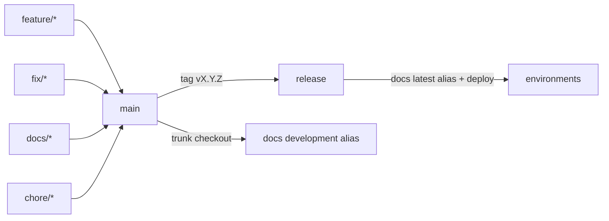

# Contributing to Inkorporated

Thank you for helping improve Inkorporated — the hybrid-cloud infrastructure and enterprise operating system monorepo.

## Quick start

1. Prefer the [devcontainer](.devcontainer/) when available.
2. Read [docs/project-conventions.md](docs/project-conventions.md) for naming, formatting, safety, docs, and testing.
3. Read [docs/guides/overview.md](docs/guides/overview.md) for product context.
4. For documentation site work: `bazelisk run //docs:serve` (see [docs/CONTRIBUTING.md](docs/CONTRIBUTING.md)).

## Branching, commits, PRs, and promotion

Inkorporated is trunk-based. `main` is the only long-lived branch. An environment is
a set of values plus a place to run, so **environments are not branches** — dev, staging,
autopush, canary, and prod are namespaces, overlays, inventory groups, and GitHub
Environments. Unfinished work ships on trunk behind a flag that defaults off.

Full rules with the tables and the promotion commands:
[docs/guides/git_workflow.md](docs/guides/git_workflow.md) and
[docs/guides/environments.md](docs/guides/environments.md).

### The trunk

| Rule | Detail |
| --- | --- |
| One trunk | `main`. It is never deleted, rebased, or force-pushed. |
| Cut from the tip | `git switch -c feature/<short-description> origin/main`, before the first edit. |
| Merge by pull request | `bazelisk test //:gate` runs on the pull request and on push to `main`. |
| Delete on merge | Removing the remote branch is part of landing the work. |
| Lifetime target | Opened and merged within days; older than 14 days means rebase onto trunk or close. |

```bash
git fetch origin
git switch -c feature/argo-appset-hardening origin/main
# ... work, commit ...
git fetch origin && git rebase origin/main   # trunk moved under you
git push -u origin feature/argo-appset-hardening
```

Rebase **your own** branch when trunk moves. Never rebase or force-push a branch someone
else has pushed to.

### Branch naming

| Prefix | Use |
| --- | --- |
| `feature/` | New functionality |
| `fix/` | Non-urgent fixes |
| `refactor/` | No behavior change |
| `docs/` | Documentation-only |
| `chore/` | Tooling, CI, dependency bumps, no user-visible behavior change |
| `ci/` | CI and gate changes |
| `test/` | Tests only |
| `perf/` | Performance work |
| `build/` | Bazel and build-system changes |

Examples: `feature/argo-appset-hardening`, `docs/enterprise-os-and-practices`,
`fix/domain-validation-false-positive`.

An urgent production fix is a normal `fix/` branch into `main`. Roll forward by
tagging the fixed tip, roll back by tagging an earlier one. There is no `hotfix/` line and
no parallel production branch to back-merge.

### Commit messages

Preferred style (Conventional Commits inspired):

```text
<type>: <short summary in imperative mood>

[optional body — why]

[optional footer]
```

**Types:** `feat`, `fix`, `chore`, `docs`, `refactor`, `test`, `ci`, `build`, `perf`

Rules:

- Summary ≤ 72 characters, imperative mood (“add”, “fix”, “update”).
- Body explains *why* when not obvious. Wrap ~72–80 characters.
- Reference issues in footer (`Closes #123`).
- Never put secrets or “WIP” in final messages.

### Pull request titles and descriptions

**Title:** Same style as a good commit summary.

**Description template:**

```markdown
## Summary
One or two sentences: *what* and *why*.

## Changes
- Concrete bullets
- New flags, env vars, config keys

## Safety / ops impact
- Domains, secrets, production access, GitOps, cyborg CRITICAL actions
- Or: “No safety impact.”

## Test plan
- Commands run (e.g. `bazelisk test //:gate`, `bazelisk test //docs:build`)

## Checklist
- [ ] Tests / validation pass
- [ ] Docs updated if user-facing or public API
- [ ] No secrets committed
- [ ] Domain templates still not hardcoding customer domains
- [ ] Any flag added is declared in `config/flags.yaml` with `default: false`, owner, expiry
```

### Review

The trunk is protected, so a pull request is the only way work lands. These are repository
settings, and they are what turn the rules above from convention into a gate:

| Requirement | Detail |
| --- | --- |
| Pull request required | Nothing is pushed to `main` directly; force-push and branch deletion are off. |
| Branch up to date | Rebase or merge trunk into your branch before the merge is offered. |
| Required checks | `bazel-tests`, `fast`, `validate-domain`, and `docs` must report green. `bazelisk test //:gate` is the lane behind `bazel-tests`. |
| Code owner approval | `.github/CODEOWNERS` names an owner for `cyborgs/`, `config/`, `infrastructure/`, `apps/`, and `.github/`, and that owner must approve. |
| Conversations resolved | Every review thread has to be closed. |

Code owner review is also how the two rules that used to live only in prose get enforced: an
AI-assisted draft needs a human reviewer before merge (`docs/CONTRIBUTING.md`), and a CRITICAL or
Family Office persona change needs the owner who reads `docs/cyborgs/schema.md`.

### Promotion (trunk → release)

Promotion names one ref or digest for every environment; nothing selects a branch.

1. Tip of `main` is green (`bazelisk test //:gate`, plus `bazelisk test //docs:build`
   when docs changed).
2. Cut a release by tagging that tip:

   ```bash
   git tag -a vX.Y.Z -m "Release vX.Y.Z"
   ```

3. The docs `latest` alias and every deploy build from that tag; the `development` alias
   builds from the trunk checkout. Each environment reads its values from its own home
   (`apps/environments/<env>/`, `infrastructure/terraform/envs/<env>/`,
   `infrastructure/ansible/inventories/<env>/`, or a GitHub Environment).
4. Do not push tags or trigger a deploy from agent automation unless a maintainer explicitly asks.

## Flags

A flag is declared once in [`config/flags.yaml`](config/flags.yaml) with `default: false`,
an owner, an expiry, and exactly one reader, and its key is documented in
`.devcontainer/.env.example`. Precedence, highest first: process environment, then
`stacks.<deploy-target-name>.<FLAG>`, then `flags.<FLAG>.environments.<env>`, then
`flags.<FLAG>.default`. Run the gate in both states before opening the pull request:

```bash
bazelisk test //:gate                        # off
FEATURE_EXAMPLE=1 bazelisk test //:gate      # on
```

Retiring a flag is one `chore:` pull request that deletes the declaration, the branch, and
the off-path together.

## Documentation

- Site engine: **Fumadocs** on Next.js (App Router). Content lives in `docs/`; the site app lives in `docs-site/`.
- Preview from the repo root: `bazelisk run //docs:serve` (hot reload, port `3005`, `PORT=` to override). The static export lands in `docs-site/out/` via `bazelisk run //docs:docs`; the strict gate is `bazelisk test //docs:build`.
- Multi-version publishing keeps two aliases, `latest` and `development`, both built from `main`: the first from the release tag, the second from the trunk checkout. `.github/workflows/deploy-docs.yml` takes the alias as an input and deploys under a GitHub Environment.
- Page standards: [docs/CONTRIBUTING.md](docs/CONTRIBUTING.md) and [docs/project-conventions.md](docs/project-conventions.md).
- Enterprise content (roles, policies, cyborgs) lives under `docs/`; machine cyborg specs under `cyborgs/`.

## Security

See [SECURITY.md](SECURITY.md). Never commit `.devcontainer/.env`, kubeconfigs, or live credentials.

## Code of conduct

Contributors are expected to follow [docs/policies/code_of_conduct.md](docs/policies/code_of_conduct.md).


## Branch and promotion model


