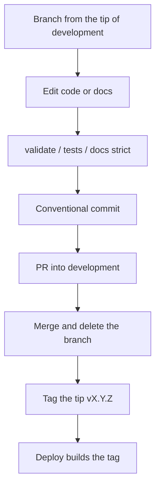

# Project conventions & style guide

**What's on this page**

- Core principles and sources of truth
- Naming, formatting, and linting across stacks
- Documentation coverage requirements
- Change discipline and non-negotiable safety invariants

**What this enables**


## Contribution flow



`development` is the trunk and the only long-lived branch. Promotion is a tag plus the
environment's own value home, never a branch name.

- Consistent contributions without hunting scattered READMEs
- Safer changes to GitOps, domains, secrets, and cyborgs

This is the **canonical human reference**. AI agents should also read root [AGENTS.md](https://github.com/toxicoder/inkorporated/blob/development/AGENTS.md). Contribution hub: root [CONTRIBUTING.md](https://github.com/toxicoder/inkorporated/blob/development/CONTRIBUTING.md).

---

## 1. Core principles

| Principle | Meaning |
| --- | --- |
| **Stability first** | Prefer reversible changes; protect prod access paths |
| **GitOps as SoT** | Desired cluster state lives in git (`apps/`) |
| **No hardcoded domains** | Use config / `{{DOMAIN_BASE}}` templates |
| **Secrets out of git** | `.env` examples only; chmod 600 local secrets |
| **Hermetic tests** | Validation runs without a live cluster when possible |
| **Docs as code** | Strict docs gate (`bazelisk test //docs:build`); enterprise OS + infra in one site |
| **Bazel-first** | Every tracked file owned by a target or a reasoned ledger entry; Bzlmod, version pinned in `.bazelversion` |
| **Least privilege agents** | Cyborg tools allowlisted; CRITICAL requires HITL |

---

## 2. Sources of truth

| Path | Authoritative for |
| --- | --- |
| `infrastructure/terraform/` | Cloud/Proxmox provisioning |
| `infrastructure/ansible/` | k3s and host configuration |
| `apps/` | ArgoCD Applications / ApplicationSets |
| `config/environments/` | Environment configuration |
| `.devcontainer/.env.example` | Documented secret *keys* (not values) |
| `docs/` | Human documentation site content |
| `cyborgs/*.yaml` | Machine agent persona specs |
| `docs-site/lib/nav.json` | Docs navigation (generated; reviewed as a diff) |

---

## 3. Naming conventions

| Area | Pattern | Examples |
| --- | --- | --- |
| Directories | `snake_case` or established tree names | `job_roles/`, `corporate_strategy/` |
| Shell scripts | `snake_case.sh` | `validate_domain_config.sh` |
| Terraform | `snake_case` resources | `module.network` |
| K8s manifests | descriptive YAML | `argocd-appset.yaml` |
| Cyborg IDs | `PREFIX####` | `EXEC0001`, `SWEN1001`, `PERS0001` |
| Branches | `type/kebab-description` | `docs/enterprise-os-and-practices` |

### Role ID prefixes

`BOARD`, `EXEC`, `SWEN`, `SREL`, `DATA`, `PROD`, `DESN`, `RSCH`, `SALE`, `MKTG`, `COMM`, `CSM`, `FINC`, `PEOP`, `LEGL`, `OPS`, `REAL`, `POLI`, `PERS`, `ITOP`, `CUST`, `REGN`, `SQAD`, `TPGM`.

---

## 4. Bazel and validation entrypoints

Bzlmod is on and WORKSPACE is off (`common --enable_bzlmod` and
`common --enable_workspace=false` in `.bazelrc`). The version is pinned in
`.bazelversion` and every command runs through `bazelisk`.

```bash
bazelisk test //:gate                       # the one command that answers
                                            # "is this repo green?"
bazelisk test //:fast                       # the same lanes minus the slow ones
bazelisk run  //:doctor                     # which host tools the gates need
bazelisk test //:validate_config_template   # env/config changes
bazelisk test //:validate_domain_config     # apps/ingress changes
bazelisk test //docs:build                  # docs changes (host lane)
```

Prefer adding new checks as `repo_sh_test` targets loaded from
`//build:defs.bzl`, with **direct labels** in `data` (no `glob()` in data).
Bazel 9 removed the native `sh_test` and left `test_suite` as a no-op stub, so
shell lanes come from `@rules_shell` through the macro and the umbrella is a
real test rather than a suite. Every test carries a lane tag: `gate` for the
hermetic lane that `//:gate` runs, or `host` plus `manual` when it needs a real
Proxmox node, a live cluster, the operator's `.env`, network egress, or the docs site's
pinned npm tree. A lane that cannot run stays tagged and named, never silently
skipped.

---

## 5. Formatting and linting

| Stack | Tooling |
| --- | --- |
| Shell | `shfmt` (`-i 2 -ci`), `shellcheck` (warnings are defects) |
| YAML | `prettier` + `yamllint` (2-space indent) |
| Terraform | `terraform fmt` / repo validate targets |
| Ansible | `bazelisk test //infrastructure/ansible:ansible_lint` |
| Bazel | `buildifier` |
| Markdown / MDX docs | language fences; `bazelisk test //docs:build` (strict) |

Pre-commit config: `.pre-commit-config.yaml` (optional local install).

---

## 6. Shell scripts

- `set -euo pipefail` on entry scripts
- Quote expansions; log diagnostics to **stderr**
- Prefer small functions; document public helpers
- No secrets in scripts or sample output

---

## 7. Terraform

- Modules under `infrastructure/terraform/`
- Use `moved` blocks when refactoring addresses
- Validate via `bazelisk test //infrastructure/terraform:terraform_fmt`; the
  `:terraform_validate` lane is tagged `manual` until the Proxmox provider
  choice is made (see the comment on that target)
- Never commit backend credentials

---

## 8. Ansible

- Roles and playbooks under `infrastructure/ansible/`
- Lint through `bazelisk test //infrastructure/ansible:ansible_lint`; under
  `REQUIRE_LINT_TOOLS=1` a missing `ansible-lint`, `yamllint` or
  `community.general` collection fails the lane instead of skipping it
- The linters are pinned in `tools/bazel/lint-requirements.txt` and install
  into a prefix with its own interpreter, so a lane runs the same release on a
  laptop and on a runner. `bazelisk run //:doctor` is the census: a required
  tool that is on PATH but cannot answer `--version` is BROKEN, and the doctor
  exits non-zero
- Inventory secrets stay local / example-only in git

---

## 9. Kubernetes / GitOps

- Manifests in `apps/shared` + `apps/environments`
- **Never** hardcode customer domains in Ingress
- Prefer ApplicationSets for multi-env
- Document PDB, resources, and secrets patterns consistently

---

## 10. Config and secrets

- Sensitive values: `.devcontainer/.env` (gitignored), mode `600`
- Validate with `bazelisk test //:validate_config`
- Run security scan tests (`//tests/config:config_security_scan`) when touching config paths

---

## 11. Documentation coverage

| Stack | Requirement |
| --- | --- |
| Shell | Purpose header; comment public functions |
| Python | Module + function docstrings (Args/Returns/Raises) where present |
| Terraform | Variable/output descriptions; module README |
| Ansible | Clear task names; role README |
| YAML GitOps | Top-of-file purpose when non-obvious |
| Cyborg YAML | Full schema; system_prompt required |
| Markdown / MDX (`docs/`) | Frontmatter (`title`, `description`, `tags`) + the **What's on this page** / **What this enables** scan list; listed in `docs-site/lib/nav.json` when user-facing |

Docs engine: **Fumadocs** on Next.js (App Router), published under the `latest` and `development`
aliases. See [docs/CONTRIBUTING.md](CONTRIBUTING.md).

### Docs linking (branch-aware)

- **Between docs pages:** relative `.md` links only (never hardcode `https://toxicoder.github.io/inkorporated/...` for in-site navigation); the site resolves a relative link to the published route.
- **Repo paths outside `docs/`:** GitHub URLs written on the trunk ref **`development`**: `.../blob/development/<path>`. An environment is a set of values, not a ref, so a doc link names trunk.
- `docs-site/lib/remark-git-ref.ts` stamps every `blob|tree/<ref>` URL it finds at build time with the ref that build was made from, so the `latest` build points its source links at the release tag. Write the trunk ref and let the build bind it; a link written on a tag (`.../blob/v1.4.0/<path>`) is left as written.
- **Do not** hardcode an absolute `github.io/inkorporated/...` URL without its `/latest/` or `/development/` alias.
- The cyborg roster pages are generated from `cyborgs/*.yaml`; regenerate them, never hand-edit them.
- Checker: `bazelisk test //docs:validate_links`.

---

## 12. Testing

- Prefer hermetic script tests
- Shell lanes are `repo_sh_test` targets from `//build:defs.bzl`
- Domain validation on every PR that touches apps/config
- Docs gate `bazelisk test //docs:build` on docs changes

---

## 13. Change discipline

1. Branch from the tip of `development`, the trunk and only long-lived branch
2. Small focused commits (conventional style)
3. Update docs when behavior or public contracts change
4. Run relevant validate/tests; a flag lands declared in `config/flags.yaml`, off by default, and the gate runs both states
5. PR into `development`, delete the branch on merge; ship unfinished work behind that off-by-default flag
6. **Agents must not push or open PRs unless the user explicitly requests**

---

## 14. Non-negotiable safety invariants

1. No live secrets in git  
2. No hardcoded production domains in Ingress  
3. `.devcontainer/.env` never committed  
4. Cyborg CRITICAL actions require human approval  
5. Family Office agents restricted invokers  
6. Do not weaken security scan or domain validation without explicit design review  
